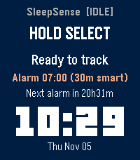
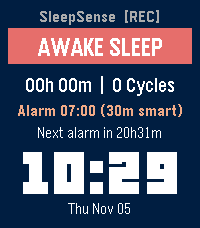
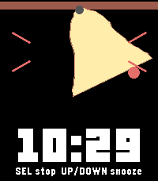
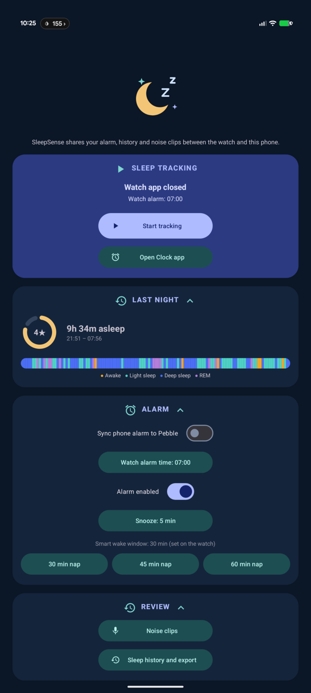
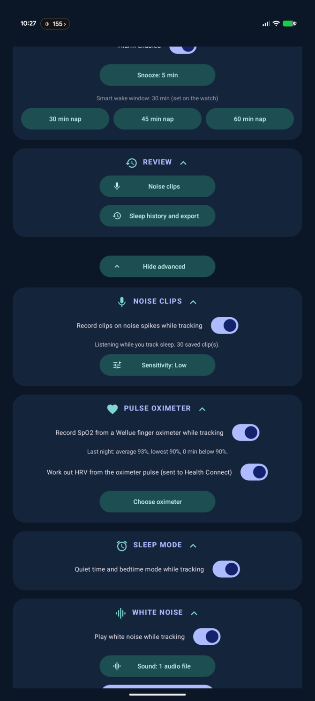
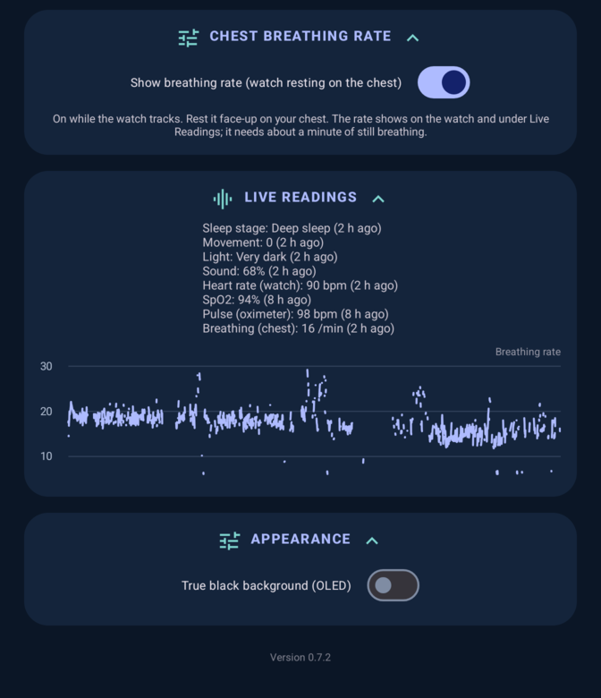
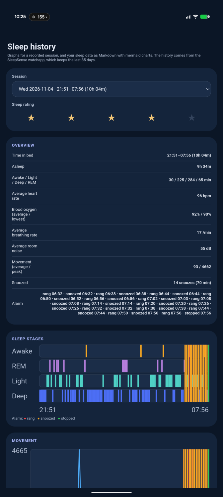
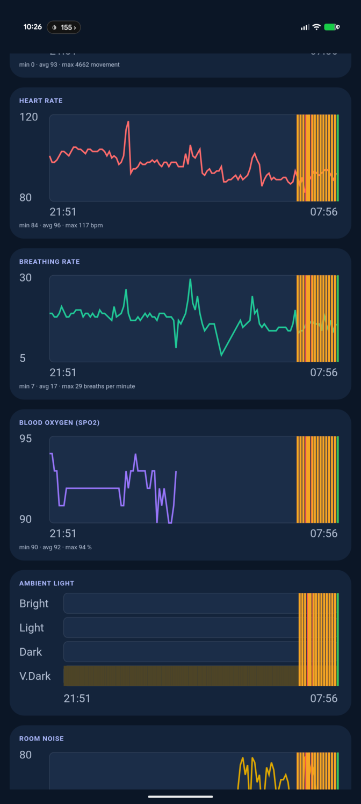
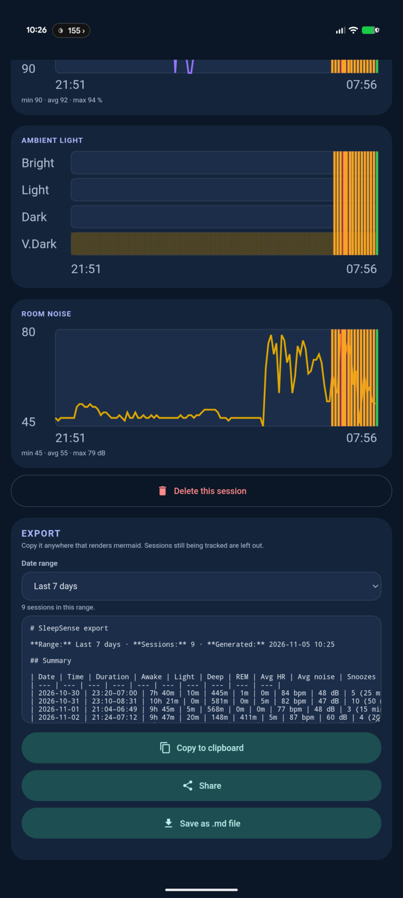
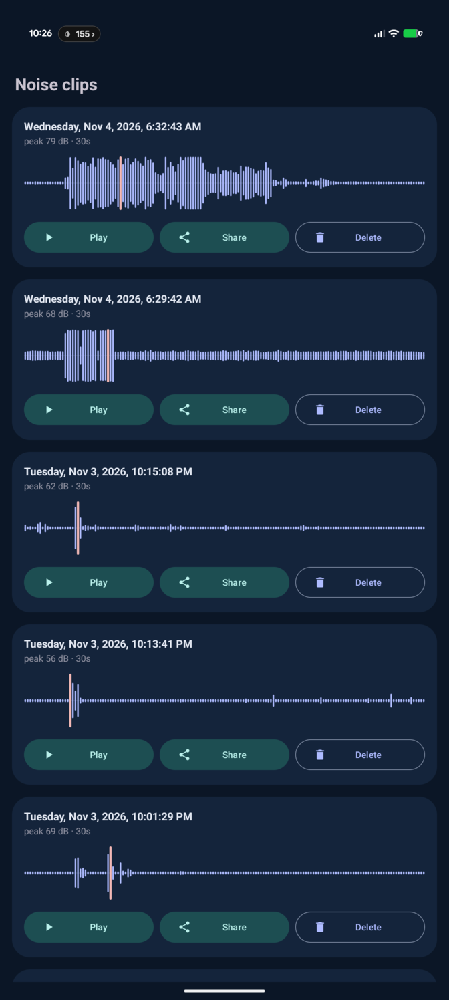

# SleepSense: Pebble Sleep Cycle Tracker

**SleepSense** is a sleep tracker and smart wake alarm for Pebble smartwatches (`aplite`, `basalt`, `chalk`, `diorite`, `emery`, `flint`, `gabbro`), with an optional **Android companion app**. The app adds a night-sky home screen with live readings, a finger-oximeter (SpO2, pulse, HRV), breathing rate from the watch on your chest, room-noise clips, sleep sounds, a sleep-mode switch for Quiet Time, Home Assistant and webhook control, sleep-history graphs and Markdown export.

It combines the watch's **accelerometer** (movement), **ambient light sensor**, **heart rate** and **breathing rate** with the **phone's microphone** to classify sleep into **Awake**, **Light (N1/N2)**, **Deep (N3/Slow-Wave)** and **REM** across ~90-minute cycles.

The watch app works on its own. Everything marked *(Android app)* needs the companion app, and the Pebble/Core Devices app on the phone.

---

## Screenshots

**Watch** (Pebble Time 2): idle, tracking, and the alarm ringing.

<table>
  <tr>
    <td align="center"><br><sub>Idle</sub></td>
    <td align="center"><br><sub>Tracking</sub></td>
    <td align="center"><br><sub>Alarm ringing</sub></td>
  </tr>
</table>

**Android app** (night sky theme, dark shown; it follows the system theme): the main screen, the Advanced section, and live readings.

<table>
  <tr>
    <td align="center" valign="top"><br><sub>Main screen</sub></td>
    <td align="center" valign="top"><br><sub>Advanced</sub></td>
    <td align="center" valign="top"><br><sub>Chest breathing and live readings</sub></td>
  </tr>
</table>

**Sleep history** (stats and graphs for a night, including heart rate, breathing rate and SpO2), **export**, and **noise clips**:

<table>
  <tr>
    <td align="center" valign="top"><br><sub>Sleep history</sub></td>
    <td align="center" valign="top"><br><sub>Heart rate, breathing, SpO2</sub></td>
    <td align="center" valign="top"><br><sub>Export</sub></td>
  </tr>
</table>

**Noise clips:**

<table>
  <tr>
    <td align="center" valign="top"><br><sub>Noise clips</sub></td>
  </tr>
</table>

The watch screenshots come from the emulator. The Android screenshots are from a real phone and night, so the figures are one person's data.

---

## Watch app

### Features

- **Sleep staging** from several sensors:
  - **Movement**: per-minute activity counts from Pebble Health (`health_service_get_minute_history`), with a raw `accel_data_service` fallback where Health history is unavailable. A minute counts as still up to 50, the quiet floor of this hardware.
  - **Ambient light**: minute-level room light (`VeryDark` … `VeryLight`) to catch lights on, sleep onset and waking.
  - **Heart rate**: read every minute while tracking (watches with a sensor only).
  - **Breathing rate**: from the watch resting on your chest, worked out on the phone *(Android app)*.
  - **REM** is a still, dark minute where the heart rate is raised against the night's deep sleep and/or breathing is uneven; every signal that has data must agree. Without that data the ~90-minute cycle is the fallback.
  - **Room noise** *(Android app)*: measured by the phone's microphone. Without the companion app no noise level is sent.
- **Smart wake alarm**: a target time plus a wake window (15 / 30 / 45 minutes). It vibrates gently once you are in light sleep inside the window, and at the exact time otherwise. A tower-bell screen with the time shows while it rings, and on watches with a speaker a chime ramps up after a few seconds. **Snooze** (off, 5, 10 or 15 minutes) is set in Settings.
- **Set the alarm time on the watch**: double-press Up or Down opens a time editor. A watch edit becomes the app's own alarm and turns off *Sync phone alarm to Pebble*.
- **Rate the night**: when the alarm ends a night, a star-rating screen follows (Up/Down to rate, Select to save). The rating shows in History and goes to Home Assistant.
- **Status screen**: state (Awake / Light / Deep / REM), time asleep and cycles, the alarm and its countdown, and the clock in the largest digits that fit. The header shows heart rate and breathing rate as `[REC]  HR 62  BR 16` (a rate the phone stopped updating drops off after a minute).
- **Keeps recording**: while tracking, the watch schedules a wakeup so the app relaunches within two minutes if the watch drops back to the watch face, and fills the gap from Pebble Health history.
- **Alarm in the timeline**: your next alarm shows as a pin in the watch's timeline (press Down on the watch face). It is a local pin made by the phone's Pebble app, so no account is needed, and it is updated whenever SleepSense is open on the watch (the alarm itself rings either way).
- **Per-sensor switches**: light, noise and heart rate can each be turned off in Settings.
- **Voice dream journal** on watches with a microphone (`basalt`, `chalk`, `diorite`, `emery`): dictate a note in the morning.

### Watch controls

Changes need a deliberate **hold** (about a second; the watch buzzes once to confirm), so a stray press while you sleep does nothing. A ringing alarm is the exception: any press stops it (and ends sleep tracking), and Up or Down snoozes it.

| Button | Hold | Press / double-press | While the alarm rings |
| :--- | :--- | :--- | :--- |
| **SELECT** | Start / stop sleep tracking | Press: refresh from the phone. Double-press: voice dream journal | Press: stop the alarm (also stops tracking) |
| **UP** | Turn the smart alarm on / off | Double-press: edit the alarm time | Press: snooze (when enabled) |
| **DOWN** | Cycle the smart wake window (15 → 30 → 45 min) | Double-press: edit the alarm time | Press: snooze (when enabled) |

In the time editor, Up and Down change the time (hold to repeat) and Select saves.

### Settings and history (phone)

Open the app's settings in the Pebble app. The page has:

- **Smart wake alarm**: on/off, wake time, wake window, snooze length.
- **Sensors**: light, room noise, heart rate.
- **Sleep history**: pick a session to see its stats and graphs: sleep stages (with the alarm ringing, snoozed and stopped marked), movement, heart rate, breathing rate, SpO2, ambient light and room noise. The phone keeps the last 35 days.
- **Export**: your sleep data as Markdown with mermaid charts, for the last 7, 14 or 30 days or since the last export. Copy it to the clipboard or download it.

---

## Android app (SleepSense Health Bridge)

The `android/` folder is a small companion app. The Pebble app will not let an Android app message the watch directly, so the watchapp's own phone-side code (PebbleKit JS) does the talking to the watch. It reaches the Android app through a **local bridge**: a foreground service listening on `127.0.0.1:8765` (loopback only, so nothing off the phone can connect).

### Main screen

A night-sky look (indigo, teal and amber; light and dark, plus an optional true-black OLED switch under *Appearance*). Each section is a card that folds when you tap its header, and the app remembers which are open.

- **Sleep tracking**: "Tracking sleep since 23:10", "Not tracking" or "Watch app closed", the watch alarm, and the **Start / Stop tracking** button. Start opens SleepSense on the watch first if needed; stopping works while SleepSense is open on the watch, and the app asks the Pebble app to open it if not. While tracking, a strip stays pinned at the top with elapsed time, heart rate, SpO2 and breaths per minute.
- **Last session**: rating ring, time asleep, and a stage ribbon.
- **Alarm**: sync the phone's next alarm, the watch alarm time, alarm on/off, snooze, the smart wake window (set on the watch), and **30 / 45 / 60 minute nap** tiles that set the watch alarm and start tracking. **Open Clock app** is in the tracking card.
- **Review**: **Noise clips** and **Sleep history and export**.
- **Show advanced**: Noise Clips, Pulse Oximeter, Sleep Mode, White Noise, Connectivity (Home Assistant, webhook, calendar, Health Connect), Interfacing (widget, **Install on Pebble**, **Check for updates**), Chest Breathing Rate, Live Readings and Appearance.
- **Install on Pebble** hands the watch app bundled in this APK to the Pebble app (choose **Pebble** in the "Open with" list), which installs it on your watch and opens it. **Check for updates** looks at the latest GitHub release of this project (quietly, at most twice a day, when the app opens) and offers **Get the update**.

### Features

- **Alarm sync (phone to watch)**: the watch wake time follows your phone's **next alarm**. Change it in the Clock app and the watch follows within a minute. If the phone has no alarm, the watch smart alarm is turned off too. The app only *reads* your alarms; it never changes them. Setting the time on the watch or in the app switches this off and keeps your own time.
- **Home-screen widget**: logo, tracking status and next alarm. Tap it to open the app. The status comes from the watch's once-a-minute check-in, so it can lag a little. The notification shows the tracked night and opens the app.
- **Sleep Mode**: while the watch tracks, the phone turns on Do Not Disturb (alarms only) and the watch's **Quiet Time**, through the built-in Quiet Time Toggle app, and undoes only what it did afterwards. Quiet Time stays on after an alarm until you have rated the night, so the rating screen is not dismissed, and goes off at once when you stop tracking by hand. Quiet Time can mute the watch's alarm chime; the vibration still works.
- **Noise tracking and clips** (opt-in, uses the microphone): while the watch is tracking, the phone listens and keeps a running average of the room level (this is also the noise reading shown on the watch). A loud sound above that average saves a **30-second WAV clip** (5 seconds before the spike, 25 after), at most one every 30 seconds, keeping the 30 newest. **Sensitivity** is Low (56 dB), Medium (48 dB) or High (42 dB). The **Noise clips** screen lists them by capture date, with a loudness graph and playhead for each, peak level, and play, share and delete. Levels are approximate dB: phone microphones are not calibrated. Place the phone near the bed.
- **White noise**: plays brown, pink or white noise while tracking, or your own audio files (played in order, with a 12 second cross fade), or a **Spotify** playlist (paste a link or share it to SleepSense; it plays through Spotify's App Remote). It stops with the tracking, and clips ignore its own sound.
- **Pulse oximeter** (opt-in, Wellue finger oximeters over Bluetooth LE): connects while the watch tracks and reconnects if it drops. The lowest SpO2 and average pulse of each 30 seconds are saved and graphed in History and the export. Optionally works out **HRV** (RMSSD, 5-minute windows) from the pulse waveform. Choose your device under *Pulse Oximeter*.
- **Chest breathing rate**: with *Show breathing rate* on and the watch resting face-up on your chest, the phone works out your breathing rate from the watch's accelerometer (each axis band-passed to 0.1 to 0.55 Hz, the strongest frequency in the direction with most motion; no reading when the tone is weak or movement dominates). It needs about a minute of still breathing, shows on the watch header and under Live Readings, and is stored with each minute for the History graph, the average in the stats, and REM detection. It is not a medical measurement.
- **Live Readings**: sleep stage, movement, light, sound, heart rate, SpO2, oximeter pulse and chest breathing with how long ago each came in, a scrolling oximeter pulse waveform, and the breathing-rate graph.
- **Sleep history and export**: the same graphs, stats and export as the settings page (they share one piece of code, `src/pkjs/lib/report-core.js`), plus delete a session. Export has **Copy**, **Share** (Android share sheet, as text) and **Save as .md file**. The history is sent from the watchapp's code whenever SleepSense is open on the watch, so open it after a night to refresh the screen.
- **Add nights to a calendar**: each finished night becomes an event in a calendar you choose.
- **Home Assistant (MQTT)** *(experimental)*: the **Home Assistant (MQTT)** screen takes your broker's host, port and optional login (port 8883 uses TLS). SleepSense publishes `sleepsense/tracking`, `stage`, `heart_rate`, `spo2`, `sleep_duration` (minutes asleep, kept after you stop) and `sleep_rating`, plus Home Assistant discovery messages, so a *Sleep tracking* switch, the sensors and a *Watch alarm time* text entity appear by themselves. The switch starts and stops tracking (`sleepsense/tracking/set`). Values only arrive when the Pebble app delivers watch messages to this app.
- **Local webhook** (for a Pebble Index ring or any automation): `POST http://127.0.0.1:47631/toggle` (also `/start`, `/stop`, and `GET /status`) with `Authorization: Bearer <token>`. Copy or regenerate the token in *Connectivity*. It listens on the phone only (`127.0.0.1`).
- **Health Connect** *(experimental)*: every 15 minutes while tracking, and when you stop, writes the sleep session (with stages), heart rate, SpO2, breathing rate and HRV. It depends on the Pebble app delivering watch messages straight to this app, which has not been confirmed to work everywhere; use the history export if you need your data out.
- Follows the system **dark / light** theme.

### Permissions

| Permission | Why |
| :--- | :--- |
| Microphone | Noise tracking and clips (asked when you switch it on) |
| Bluetooth (scan, connect) | The pulse oximeter |
| Calendar (read, write) | Adding nights to a calendar |
| Notification policy (Do Not Disturb access) | Sleep Mode's alarms-only setting |
| Foreground service (special use, microphone) | The bridge runs all the time; the microphone type is added only while listening |
| Notifications | The bridge's foreground notification |
| Internet, Local network | The local socket and webhook on `127.0.0.1`, the MQTT broker, Spotify, and the update check (a single request to `api.github.com`) |
| Wake lock | Keeps a playing sound's cross fade going with the screen off |
| Receive boot completed | Restart the bridge after a reboot or an app update |
| Set alarm | Registers the app as an alarm app |
| Health Connect (write sleep, heart rate, SpO2, respiratory rate, HRV) | The experimental Health Connect export |

### Local bridge (for the curious)

The app listens on `127.0.0.1:8765` (loopback only).

| Request | What it does |
| :--- | :--- |
| `GET /alarm[?tracking=0\|1&since=ms&...]` | Next phone alarm and a change counter; the optional query is the watch's check-in (tracking state, stage, heart rate, quiet time, alarm time, rating pending) |
| `GET /command` | Held open up to 25 s; returns `start`, `stop` or `none` for a button request, and carries the breathing rate back to the watch |
| `POST /sessions` | The watchapp's sleep history (JSON) |
| `GET /noise`, `/noise/start`, `/noise/stop` | Noise level, and start/stop listening |
| `POST /chest` | Chunks of the watch's chest accelerometer samples, for the breathing rate |

### Build and install the Android app

Needs JDK 21 and the Android SDK (min SDK 28). From the repository root:

```sh
cd android
./gradlew assembleDebug
adb install -r app/build/outputs/apk/debug/app-debug.apk
```

The **Install on Pebble** button needs the watch app to be bundled in the APK: run `pebble build` in the repository root *before* `./gradlew assembleDebug` (the build copies `build/PebbleSleepSense.pbw` into the app; without it the button explains what to do).

Open the app once so it can start the bridge (it restarts itself after updates and reboots). The history screen bundles `src/pkjs/lib/report-core.js` through a symbolic link in `android/app/src/main/assets/`.

---

## Project structure

```
Pebble-SleepSense/
├── package.json                   # App UUID, capabilities, message keys, menu icon
├── wscript                        # Pebble build configuration
├── resources/images/icon.png      # Watch app menu icon
├── docs/screenshots/              # Images used in this README
├── src/
│   ├── c/                         # Watch app
│   │   ├── pebble_sleep_sense.c   # Entry point and wiring
│   │   ├── model/sleep_types.h    # SleepStage, SleepEpoch, SleepSession, alarm and sensor settings
│   │   ├── engine/                # Sleep staging, tracking session, smart alarm and snooze
│   │   ├── comm/                  # AppMessage with the phone, dictation, chest samples
│   │   └── ui/                    # Status screen, alarm time editor, rating screen, hold-to-change buttons
│   └── pkjs/                      # Phone-side JavaScript (runs in the Pebble app)
│       ├── index.js               # Messages with the watch, history, settings, bridge calls
│       └── lib/
│           ├── config-page.js     # Settings page (alarm, sensors, history, export)
│           ├── history.js         # 35 days of per-minute history, bucketed for graphs
│           ├── report-core.js     # Graphs and Markdown export (shared with the Android app)
│           ├── phone-alarm.js     # Asks the Android app for the next alarm and commands
│           ├── session-push.js    # Sends the history to the Android app
│           └── noise-bridge.js    # Starts/stops phone noise monitoring
└── android/                       # Companion app (Kotlin)
    └── app/src/main/
        ├── java/net/webstas/sleepsense/
        │   ├── MainActivity.kt, HistoryActivity.kt, ClipsActivity.kt, HomeAssistantActivity.kt
        │   ├── AlarmBridgeService.kt   # The local bridge (foreground service)
        │   ├── PhoneAlarmSync.kt, TrackingControl.kt, WidgetState.kt, SleepWidgetProvider.kt
        │   ├── WebhookServer.kt, WebhookPrefs.kt   # Local webhook
        │   ├── BedtimeMode.kt          # Do Not Disturb and watch Quiet Time while tracking
        │   ├── NoiseMonitor.kt         # Microphone level, spike detection, clips
        │   ├── WhiteNoise.kt, SpotifyRemote.kt, SpotifyLink.kt   # Sleep sound
        │   ├── Oximeter.kt, PulseVariability.kt, WaveformView.kt  # Wellue oximeter: SpO2, pulse, HRV
        │   ├── ChestCapture.kt, BreathingRate.kt, ChestRateView.kt  # Breathing rate from the chest
        │   ├── LiveReadings.kt         # Live readings and graphs
        │   ├── HomeAssistant.kt        # MQTT and discovery
        │   ├── CalendarSync.kt, UpdateChecker.kt
        │   ├── SessionStore.kt, SleepSession.kt, SleepListenerService.kt   # History and Health Connect
        │   └── BootReceiver.kt
        ├── assets/                     # history.html and a link to report-core.js
        └── res/                        # Layout, themes, icon, widget
```

---

## Build and install the watch app

```sh
pebble build
```

Emulators:

```sh
pebble install --emulator basalt    # Pebble Time (colour)
pebble install --emulator chalk     # Pebble Time Round
pebble install --emulator diorite   # Pebble 2 HR (monochrome, heart rate, microphone)
pebble install --emulator emery     # Pebble Time 2
```

A physical watch, through the Pebble app's Developer Connection:

```sh
pebble install --phone <PHONE_IP_ADDRESS>
```

If the phone is plugged in by USB but not reachable over Wi-Fi, tunnel the connection through adb:

```sh
adb forward tcp:9000 tcp:9000
pebble install --phone 127.0.0.1
adb forward --remove tcp:9000
```

---

## Known limits

- **Noise** is real only with the Android app; the dB values are approximate.
- **Breathing rate** needs the watch resting on your chest and about a minute of still breathing. It has been compared with manual counts, not a clinical device. The oximeter's waveform does not give a usable breathing rate.
- **Quiet Time** can mute the watch's alarm chime (apps cannot use the speaker priority Quiet Time leaves open); vibration still works.
- **Start/stop from the phone** (button, webhook, Home Assistant) needs the Pebble app connected; a stop is delivered while SleepSense is open on the watch, and the app asks the Pebble app to open it.
- **History** reaches the Android app only while SleepSense is open on the watch.
- **The alarm sync is one-way** (phone to watch) on purpose, and a time set on the watch turns it off: Android has no safe way to switch a Clock-app alarm back on, and turning one off disables the whole repeating alarm.
- **Health Connect** export is experimental (see above).
